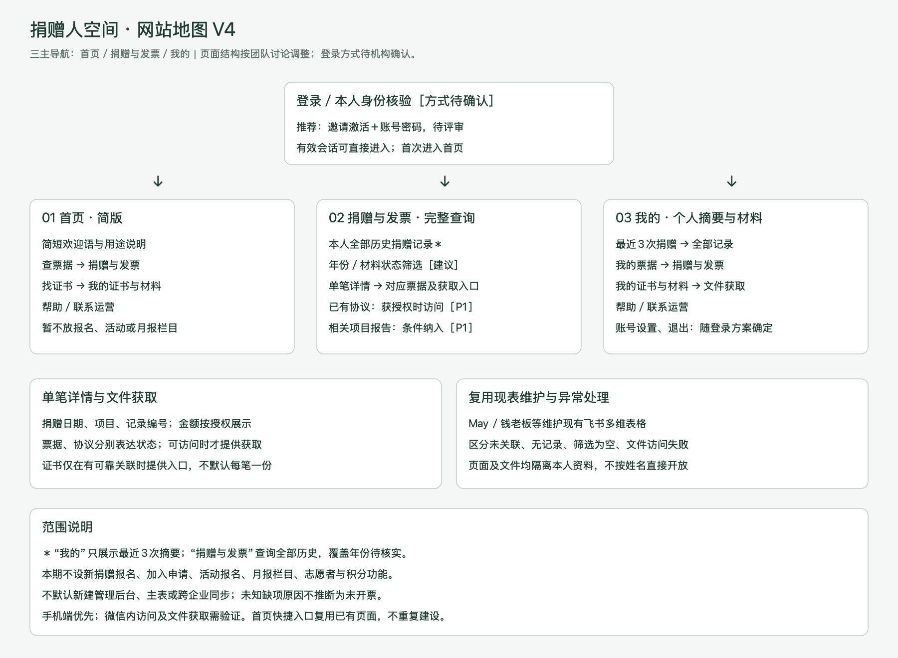

# G24\-【需求澄清】ABC创投分社\-码上美好\-网页应用

**版本：** 内部评审稿 V1.2｜2026-11-24  
**状态：** 用于团队制作11月27日Demo；团队方案不等同于机构同意。

**本次聚焦：依托现有飞书多维表格，改善个人捐赠人在手机上查询本人捐赠、获取票据与证书的体验，减少重复询问。**

> **🧭 目录**
> 
> 一、机构基本信息
> 
> 二、机构数字化现状
> 
> 三、需求聚焦
> 
> 四、功能需求与交互规则
> 
> 五、实施计划
> 
> 六、机构核对与待办清单
> 
> 七、验收检查
> 
> 附录：需求演变与资料说明
> 
> 

---

## 🏢 一、机构基本信息

|项目|目前掌握的信息|
|---|---|
|合作机构|ABC公益创投分社，与ABC总部协作|
|成立时间、发展阶段|捐赠圈业务已运营约两年，现有大几十名捐赠人。 随着人数增加，票据、证书查询和资料补发等人工工作变多。|
|公益领域|分社主要运营捐赠圈业务，连接捐赠人与公益组织。捐赠人向公益项目提供资金，也可能参与项目沟通和后续活动。|
|服务对象|**本期主要用户：** 个人捐赠人，使用网页查询本人捐赠记录、获取已有票据和证书。 **资料维护人员：** May、钱老板等，原则上继续在现有飞书多维表格中维护，不默认新建管理后台。|
|用户规模|大几十名捐赠人，**不到100人**；90%以上为个人。 **本期先按个人捐赠人设计，不覆盖机构捐赠人。**|
|人员规模|总部**约4—5名全职伙伴**，分社项目主要由志愿者参与；分社全职人数及机构总人数**未提供**|
|业务数据规模|票据**约100—200张**，总捐赠额**约200多万元、未超过300万元**，单张多为1—2万元|

---

## 🧭 二、机构数字化现状

### 1️⃣ 已有工具与业务基础

已具备报名收集、资料存储、查询的**基础能力**，核心问题是**内容完整性、使用体验和持续运营**。

|工具／系统|目前用途|与本次需求相关的问题|
|---|---|---|
|飞书多维表格|报名信息、协议、票据统一管理，由May及钱老板维护|字段开放范围未统一提供给项目组； 部分协议、投后报告尚未收齐；更新依赖人工|
|现有飞书查询链接|捐赠人输入姓名后查看相关记录，**无需注册飞书账号**|呈现类似填完的问卷，缺乏清晰的个人服务分区； 身份核验及可见范围需单独核实|
|飞书文档／文件夹|投后报告、项目资料挂载至相关捐赠人记录|部分报告尚未收齐，链接授权与持续可访问性需检查|
|微信、微信群|日常沟通、通知和文件分发|历史消息难查，文件失效后需人工补发；用户使用习惯主要在微信|
|Excel|早期项目管理工具|当前是否仍有独立数据需要核实，不默认安排迁移|
|现有微信志愿者小程序|志愿者报名、证书等功能|服务对象不同，**不属于本次改造范围**；可参考其体验，不能视作现成捐赠人系统|

- 🔗 **现有查询入口**（仅为资料引用，资料中提供，页面与权限待核验）：[捐赠人查询页](https://x5zfgru9i7.feishu.cn/share/base/query/shrcnRQ78GeoF1otfhVum1THXAg)

- 🔗 **投后管理表（背景参考，非本期范围）**：[投后管理工作表单 副本](https://x5zfgru9i7.feishu.cn/base/JwvobLBelaq0GXs8ESBcAtpQnlc?from=from_copylink)

### 2️⃣ 尚未形成完整闭环的业务

- ⚠️ **协议盖章、票据开具及返还**受嘉实相关流程影响，May需催收并手动上传；项目组不能通过前端开发直接解决材料产生滞后。

- ⚠️ **投后资料**涉及打款、立项、报告产出等多个环节，难以按固定时间推进。

- ⏸ **全旅程门户、捐赠人活动报名、自动通知**等仍属延展方向，未形成已确认的本期需求。

---

## 🎯 三、需求聚焦

### 1️⃣ 本次具体解决的问题

> 💡 **核心目标**：在已有飞书多维表格及查询能力上，优化个人捐赠人的自助查询体验，让捐赠人通过手机清楚找到自己的捐赠记录、票据和证书，了解材料是否可获取；减少翻群消息和反复询问运营人员。
> 
> 

本文统一使用“票据”（客户原文也称“发票”）；导航沿用“捐赠与发票”。协议及项目报告为P1，已有资料且获授权时纳入。

### 2️⃣ 用户与任务

| 用户 | 入口 | 主要任务 | 设备 |
|---|---|---|---|
| 个人捐赠人 | 网页链接，微信内访问待验证 | 查询本人记录，获取已有票据、证书 | 手机优先 |
| 资料维护人员 | 现有飞书多维表格 | 核对归属、上传和更新材料 | 沿用现有方式 |

### 3️⃣ 核心用户故事与关键流程

| 编号 | 用户故事 | 依据 | 主流程 |
|---|---|---|---|
| US01 | 作为捐赠人，我希望找到某次捐赠的票据并获取，不必翻群消息或找人补发 | 初始需求“发票查询与下载”、11月19日会议 | 网页链接 → 身份核验 → 首页查票据 → 捐赠与发票 → 单笔详情 → 获取文件 |
| US02 | 作为捐赠人，我希望重新获取未保存或已失效的证书，不必再次联系工作人员 | 11月19日会议 | 首页找证书或“我的” → 我的证书与材料 → 获取证书 |
| US03 | 作为维护人员，我希望继续在现表更新资料，不用重复维护两套数据 | 11月18日May聊天记录 | 原表找到记录 → 核对归属 → 更新保存 → 网页核对 |

查询无结果可清除筛选；请求失败可重试；未关联、材料缺失或文件打不开时可联系运营。详情返回列表时保留筛选；材料页可返回原入口。具体规则见第四章。

### 4️⃣ 网站地图

### 5️⃣ 候选页面线框图

### 6️⃣ 预期结果与建议验收

手机上能找到本人记录并实际获取已有文件；记录和材料归属清楚，异常有提示；原表更新无需重复录入。具体检查见第七章。

演示时请老师对比新旧入口是否更容易使用。上线后可观察重复咨询情况，不默认新增统计埋点或量化目标。

---

## 🔐 四、功能需求与交互规则

### 0️⃣ 首版落地方式：飞书生态应用

2026-11-24团队明确：首版基于飞书生态落地，以飞书多维表格作为业务数据底座，优先复用现有附件、文档、权限和应用能力。具体采用飞书应用中的网页／门户或其他可行形态，由技术验证后确定；不默认另建业务数据库或独立账号后台。

先验证飞书原生身份与权限能否支持目标捐赠人、历史资料关联和文件获取。若无法满足，再评估邀请激活＋账号密码等补充方案；该方案不再作为默认实施方案。基于飞书不等于已经决定强制注册飞书，账号门槛及实际访问路径需演示并请机构确认。

手机优先；优先验证飞书内核心流程，再检查微信内链接及手机浏览器。若有额外授权、账号或跳转限制，必须说明，不承诺全程免登录。优先使用免费能力；如需少量服务端适配，先明确必要性、运行位置、费用与维护，不把独立系统作为默认路线。

### 1️⃣ 功能清单

以下优先级为团队建议，待机构确认。P0为核心交付，P1条件具备时实现，不阻塞P0。最终产品要求不代表27号Demo已完成真实数据联调。

| 编号 | 功能 | 优先级 | 验收关联 |
|---|---|---|---|
| F01 | 本人身份核验与资料隔离 | P0 | T01、T07 |
| F02 | 近期摘要与历史查询 | P0 | T02、T03 |
| F03 | 单笔详情与票据获取 | P0 | T04 |
| F04 | 证书获取 | P0 | T05 |
| F05 | 缺项提示与帮助 | P0 | T03、T06 |
| F06 | 复用现有维护方式 | P0 | T08 |
| F07 | 协议获取 | P1 | T09 |
| F08 | 项目报告查看 | P1 | T09 |
| F09 | 细分办理进度 | P1 | T10 |

**整体要求：** 手机端优先，优先验证微信内链接访问及文件获取；历史数据覆盖范围、文件打开方式需进一步核实。

**本期不做：** 新捐赠报名、活动报名、志愿者管理、积分等级、完整全旅程门户；不默认新建管理后台、跨企业同步或升级投后管理表。

### 2️⃣ 功能规则

| 功能 | 入口与操作 | 处理及反馈 | 特殊情况 |
|---|---|---|---|
| F01 身份核验 | 无有效会话时进入核验；方式待确认，优先验证飞书身份及权限能力 | 通过后关联本人记录，首次进入首页；会话过期重新核验后返回来源页 | 失败可重试；未关联或同名由运营核对，不按姓名自动合并。若采用账号密码，邀请、密码恢复和会话规则需在方案确认后细化 |
| F02 摘要与查询 | “我的”最近3次 → 单笔详情；“全部”及首页查票据 → 捐赠与发票 | 按捐赠日期从近到远；不足3次按实际展示。历史查询不截为3条，尚无票据的记录仍保留。年份和状态筛选按可靠字段提供 | 历史年份及缺失情况待核实；无记录、筛选无结果与加载失败分开提示；返回保留筛选 |
| F03 单笔详情与票据 | 列表进入详情 → 查看或获取票据 | 项目、日期、记录编号；金额按授权展示。每笔独立协议与票据，不合并开票。实际打开或下载才算获取 | 已开具不等于已上传；未提供显示说明；文件访问失败可重试、返回或联系运营 |
| F04 证书 | 首页找证书或“我的”进入材料页 → 选择证书 | 按实际发放粒度归属，不默认每笔一份；有可靠关联时详情可链接到同一文件 | 无证书显示暂未提供；获取失败可重试或联系运营 |
| F07 协议 | 单笔详情 → 已有协议 | 获授权时查看或获取；不承担在线签署、盖章 | 缺附件不推断未签署或盖章中 |
| F08 项目报告 | 相关详情或材料页 → 项目报告 | 仅展示本人相关且获授权的现有文档或文件夹，不建完整报告中心 | 不推算发布日期；跳转文档需说明，权限受限可反馈 |
| F06 资料维护 | 授权维护人员在原飞书表中更新 | 核对归属后保存，网页在约定时限内反映，不重复录入；时限待联调确认 | 上传失败重试；归属不明先核实；网页未更新检查关联、同步及权限 |

### 3️⃣ 共用状态与帮助（F05、F09）

| 状态 | 页面表现与操作 |
|---|---|
| 加载中 | 显示等待提示；提交、文件获取时避免重复操作 |
| 可获取 | 显示明确的查看或下载入口，方式须经目标手机环境验证 |
| 暂未提供 | 不编造原因；有核实原因再展示，不把空附件等同未开票 |
| 无记录／筛选无结果 | 分别提示，后者可清除条件；有疑问可联系运营 |
| 请求失败／文件无法访问 | 保留上下文，提供重试、返回及联系入口 |
| 无权限／会话过期 | 不返回他人资料；过期引导重新核验 |
| 细分办理进度（P1） | 仅在运营可核实并持续维护时展示待返还、待上传等状态；票据、协议分别维护，不自动推算时间 |

首页、“我的”及异常处提供帮助。联系渠道由机构确认，不默认开发反馈表或在线客服。未核实的联系入口不能作为正式发布能力。

### 4️⃣ 最小数据与权限约定

下表为逻辑需要，先映射现表，不要求新建同名数据表。具体字段、存储及接入方式待核验。

| 对象 | 必要信息 | 约定 |
|---|---|---|
| 捐赠人 | 稳定内部标识、展示姓名、身份关联 | 不以姓名作为唯一归属依据 |
| 捐赠记录 | 记录标识、本人关联、日期、项目、关联材料 | 金额授权后展示；无票据仍保留记录 |
| 材料 | 类型、所属人／记录／项目、附件或链接、已核实说明 | 证书、协议、票据按本人隔离；报告逐项授权 |

Demo使用模拟数据和示例附件。真实联调前须明确字段与附件授权，手机号、住址不纳入当前项目可用范围。正式实现需由飞书受控权限或必要的受控服务端校验记录和文件权限，不能返回整表后仅靠页面隐藏；接口密钥不得放入网页或PRD。

**附图使用说明：** 三主导航及页面布局继续沿用；身份核验附图中的邀请激活＋账号密码仅保留为备选示意，不作为本版实施依据，登录图须随飞书可行性结论更新。

### 5️⃣ 页面与视觉约定

导航为首页／捐赠与发票／我的；首页只提供简短介绍、查票据、找证书及帮助。详情和材料为下级页，多个入口复用同一页面和文件来源。附图是低保真结构建议，图中的规则注释不是必须展示给捐赠人的文案。

手机优先，电脑端视资源补充。Logo和视觉参考未到位时采用临时标识与简洁样式，Demo后收集意见，不视为品牌定稿。

---

## 🗓 五、实施计划

除11月27日Demo、12月11日最终交付外，下列安排为团队建议。27号前不依赖新增机构沟通推进。

| 时间 | 工作与交付 |
|---|---|
| 11月24—26日 | 优先在飞书测试多维表格配置模拟数据和示例附件，验证数据读取与原表更新，再制作核心流程；测试手机访问、文件获取及主要异常，整理待确认问题 |
| 11月27日 | 提交Demo；向汪老师、李老师约演示时间，会议时间待定 |
| 11月28日—12月10日 | 根据反馈迭代；协调授权字段及样本，条件具备后联调真实数据与文件 |
| 12月11日 | 交付代码／配置、运行说明、字段映射、权限及维护说明、已知限制，完成交接 |
| 正式发布前 | 机构确认真实资料归属、权限、缺项接受范围、联系渠道及运行接管 |

**27号Demo范围：** 首页、最近3次摘要、历史查询、单笔详情、示例票据与证书获取、主要异常；身份核验优先按飞书可行方案演示，标明待确认。P1只在不影响核心流程时演示。模拟登录或数据隔离演示不代表真实权限验证通过；实际实现程度和限制随Demo说明。

团队认领需求对接、页面、数据开发、测试交付责任，可兼任。正式上线不等于课程交付，时间由机构决定。

---

## 🤝 六、机构核对与待办清单

**✅ 已明确口径**

- 个人捐赠人优先、志愿者不在范围、手机端优先、每笔独立合同与票据、首版聚焦自助查询获取及体验。

- 会议给出 **11月27日** 和 **12月11日** 两个交付节点。

- 现有数据**已归集一表**、查询**无需注册飞书**、材料**仍缺失**。

**☐ 待办事项**

机构统一对接汪老师、李老师，由两位老师协调数据维护人员；不直接假定May等已承诺配合时间。

| 事项 | 建议处理方式 | 后续确认安排 |
|---|---|---|
| 登录方案 | 先验证飞书身份及权限，用测试账号演示，标待确认 | Demo评审确认是否接受，之后细化核验及恢复责任 |
| 数据与样本 | 优先用飞书测试表中的模拟记录和示例附件完成流程；权限未就绪可暂用本地模拟，必须标明未验证接入 | Demo后协调字段、脱敏样本和授权 |
| 材料与状态 | 演示基本可用状态，不编造办理进度 | 核实证书归属、历史范围、状态维护及审核要求 |
| 访问与文件 | 团队先测手机浏览器、微信内访问，记录限制 | 演示实际路径，确认能否接受跳转等替代方式 |
| 视觉素材 | 临时标识及简洁样式 | 收集Logo、参考界面及视觉反馈 |
| 演示与需求确认 | 准备操作路径和未决项，不冒充机构结论 | 提交Demo时约演示，明确最终需求确认人 |
| 部署与接管 | 列出托管、费用、账号、维护和反馈责任缺口 | 最终交付前由机构及G24落实 |

---

## 七、验收检查

以下为待执行用例，不代表已通过。Demo以模拟数据执行，优先验证飞书测试表读取、附件和更新链路；若暂用本地模拟，明确未通过集成检查；涉及真实权限、原表更新的检查，在正式联调后执行并补结果及证据。

| 编号／关联 | 前提与操作 | 预期结果 | 当前结果 |
|---|---|---|---|
| T01 F01 | 测试账号按演示方案进入；再尝试错误凭据及过期会话 | 正确进入本人空间；错误有提示、可重试；过期需重新核验 | 未执行 |
| T02 F02 | 一人准备至少4笔、跨年份记录，查看“我的”，再点全部及详情 | 摘要最近3笔；全部可见其余记录；详情一致，返回保留筛选 | 未执行 |
| T03 F02/F05 | 分别准备无记录、筛选无结果、请求失败 | 三种提示不同；可清除筛选或重试，不把失败写成无捐赠 | 未执行 |
| T04 F03 | 选择有票据及无票据记录，执行获取 | 已有文件实际可打开／保存；无票据记录保留，不推断未开票 | 未执行 |
| T05 F04 | 选择本人已有证书，获取后返回 | 文件正确可用，返回材料页；不强制一笔一证书 | 未执行 |
| T06 F05 | 模拟缺附件、失效链接及网络失败 | 有对应说明、重试／返回／联系入口，未知原因不编造 | 未执行 |
| T07 F01 | 两人及同名记录，修改详情参数并直接访问他人文件 | 均无法取得他人私有资料；正式环境重新验证服务端及文件权限 | 未执行 |
| T08 F06 | 获授权后在原表更新一份样本材料，再查看网页 | 约定时限内正确反映，无需重复录入，文件授权正确 | 待真实联调 |
| T09 F07/F08 | 若纳入P1，访问协议及本人相关报告，并尝试无权限文件 | 归属、链接正确；未授权不可获取；缺项有说明 | 待确定P1范围 |
| T10 F09 | 若纳入P1，分别修改票据和协议的可靠状态 | 独立正确展示，不从附件推算进度或承诺日期 | 待确定P1范围 |
| T12 飞书接入 | 在飞书测试表更新模拟记录及示例附件，再从应用读取 | 数据与文件可正确读取，更新可见且权限符合约定；仅本地模拟不能判为通过 | 未执行 |
| T11 核心流程 | 在约定手机浏览器及微信内走查查询、获取和返回 | 记录各环境真实结果；受限路径有说明，替代方式待机构接受 | 未执行 |

正式验收人、主验收浏览器、历史覆盖及更新时限待确认。无真实文件访问验证，不以按钮出现作为通过。

---

## 📎 附录：需求演变与资料说明

|事项|02初始设想|03后续澄清与本稿采用口径|
|---|---|---|
|身份识别|强制飞书账号登录，以 `open_id` 贯穿旅程|现有查询无需注册飞书；会议希望降低使用门槛，也接受基于飞书的链接方案。 新方案是否必须登录、如何保护本人数据仍待验证|
|服务对象|含角色选择及活动报名等设想|会议明确首版按个人捐赠人做，机构捐赠人和志愿者管理不在范围内|
|终端与载体|飞书应用／门户，形态待评估|手机优先；客户偏好微信使用习惯，但本期按飞书生态推进，接受链接形态，重点是便捷体验|
|范围|报名、查询、个人中心及全旅程|先改善票据查询下载、证书获取和个人信息组织；全旅程、活动报名等是延展需求|
|替代选题|以捐赠人空间为主|May建议升级投后管理表，因数据相对易开放、需求较明确；这是**备选建议**，未见双方统一切换项目方向的结论|
|时间|约两周初版|11月27日第一版Demo，至12月11日期间一次迭代，12月11日最终交付；正式发布与课程交付分别管理|

